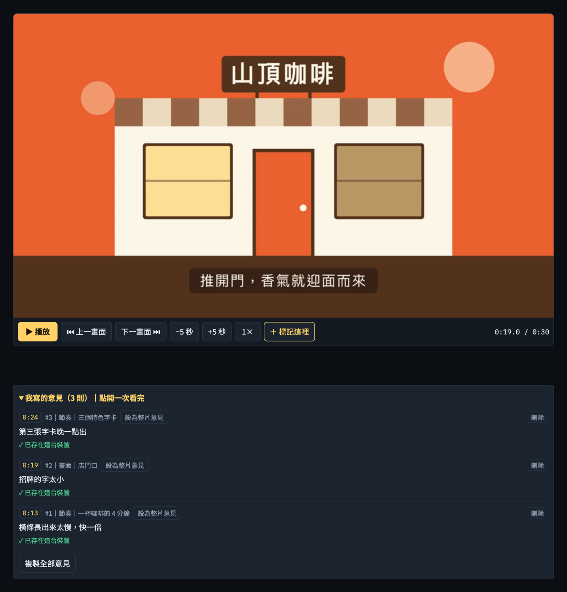

# Review Desk

[繁體中文](README.md)

**AI makes the video. You review it. Point at a shot and that's the one it fixes.**

Review Desk is a skill for AI agents (Claude Code, Codex and others) that turns a finished video into a review page. You write comments on the picture, and every comment the AI receives carries the time, the shot name and the source file, so it changes only the shot you pointed at.

<!-- EN screenshot: docs/img/en/hero.png -->


[Intro page and live demo](https://betterconnie.github.io/review-desk/)　|　[User guide](references/user-guide.en.md)

## The problem it solves

You watch the film an AI made, go back to the chat, and type "something is off around 1:23". It changes the title card at 1:20. You meant the transition at 1:25. You explain more, and it redoes the whole section and swaps out shots that were fine.

A film is made of shots. A chat box has one line.

## What is in it

- **Shot timeline**: every shot of the film in one row of thumbnails, with the sound level and the subtitles next to it.
- **An ID card for every shot**: stop on a shot and the panel shows how long it is, how it was made and where the asset came from.
- **Write where you watch**: click "+ Mark here" to pin a comment to that second. What you type is saved as you type, and survives a refresh.
- **Hand it all over in one click**: one button turns every comment into a single list.

  ```
  [v1] From Review Desk: 2 comments; version not approved yet.
  [0:13 | Shot 4 "A cup in 4 minutes" | Made in-house, no outside assets] The bar grows too slowly
  [0:19 | Shot 5 "Storefront" | Made in-house, no outside assets] The sign text is too small
  ```

- **Nothing passes until you approve**: "Approve this version" takes two clicks to take effect, and when a new version comes out, the old approval no longer counts.
- **Works on a phone.**
- **The film stays on your computer**: by default it opens one local web page, and neither the video nor the comments are uploaded (the page only asks Google Fonts for font files).

## No install: the browser version

Open the [browser version](https://betterconnie.github.io/review-desk/app/?lang=en) and drop a video in. Nothing is uploaded; everything runs in your browser, and shots are cut automatically from picture changes. Install the skill below when you want your own shot names and sources, subtitles, or an AI agent to open the desk for you.

## Install

You need Python 3.9 or later and ffmpeg. There are no packages to install.

Claude Code:

```bash
git clone https://github.com/betterconnie/review-desk ~/.claude/skills/review-desk
```

Other AI agents: put this folder where the agent can read skills, or just ask it to read `SKILL.md`.

After installing, run the self-check once:

```bash
python3 ~/.claude/skills/review-desk/scripts/make_board.py --selftest
```

## Use

Tell your AI agent: "When the film is done, open the review desk for me." It follows `SKILL.md`.

To do it yourself:

```bash
python3 scripts/make_board.py your-video.mp4 --out review_v1 --title "Film title" --ver v1 --lang en
cd review_v1 && python3 -m http.server 8787 --bind 127.0.0.1
```

Open `http://127.0.0.1:8787/`. Without a shot list, the script detects shot changes automatically. With one (`--shots shots.json`), each shot also shows how it was made and where its asset came from. `--lang en` gives the English interface; leave it out for Traditional Chinese.

Try the demo film first:

```bash
python3 scripts/make_board.py demo/demo.mp4 --shots demo/demo.shots.json --srt demo/demo.srt --out review_demo
cd review_demo && python3 -m http.server 8787 --bind 127.0.0.1
```

Then open `http://127.0.0.1:8787/`. The demo film and its shot list are in Traditional Chinese; the interface language is set by `--lang`.

## Reviews for clients or colleagues (optional)

`cloud/` can combine several review desks into one site on Netlify: one fixed address, comments that follow you between phone and computer, and no sign-up for the reviewer. Steps and cautions are in [cloud/README.en.md](cloud/README.en.md). Until you set a password, anyone with the link can watch the film.

## Files

| Location | Contents |
|---|---|
| `SKILL.md` | Skill instructions for AI agents (Traditional Chinese, with an English section) |
| `scripts/make_board.py` | Video to review desk folder (`--lang zh\|en`) |
| `assets/page.tpl.html` | Review desk page template, Traditional Chinese (single file, no framework) |
| `assets/page.tpl.en.html` | The same template in English, kept line for line |
| `references/user-guide.en.md` | Guide for the reviewer (Chinese: `references/操作說明.md`) |
| `references/data-format.en.md` | Data format (advanced) |
| `cloud/` | Optional cloud sync (Netlify Functions and Blobs) |
| `demo/` | Demo film "Summit Coffee, Opening Teaser" (original title in Chinese), CC0 |
| `docs/` | Intro web page |

## Known limits

- Automatic shot detection looks at brightness differences, so a cut between colors of similar brightness is missed. Use `--scene 0.1` or write the shot list yourself.
- In local mode, comments live only in the browser of that one computer.
- `--out` refuses to run when it points at a folder that already holds other files, so your things are not overwritten.
- The cloud backend is meant for one reviewer: if two people edit the same comment at once, the later write wins.
- The page loads its fonts from Google Fonts and falls back to system fonts when offline.
- It has so far been tried in practice only with Claude. A comment list is plain text, so you can paste it to any AI.

## Where it came from

This was forced into existence while making two YouTube channels, by the problem of not being able to say exactly what to change. After a few episodes of use it was cleaned up for release.

## License

Code: [MIT](LICENSE). Demo film: CC0.

Report problems or suggestions by opening an [Issue](https://github.com/betterconnie/review-desk/issues).
