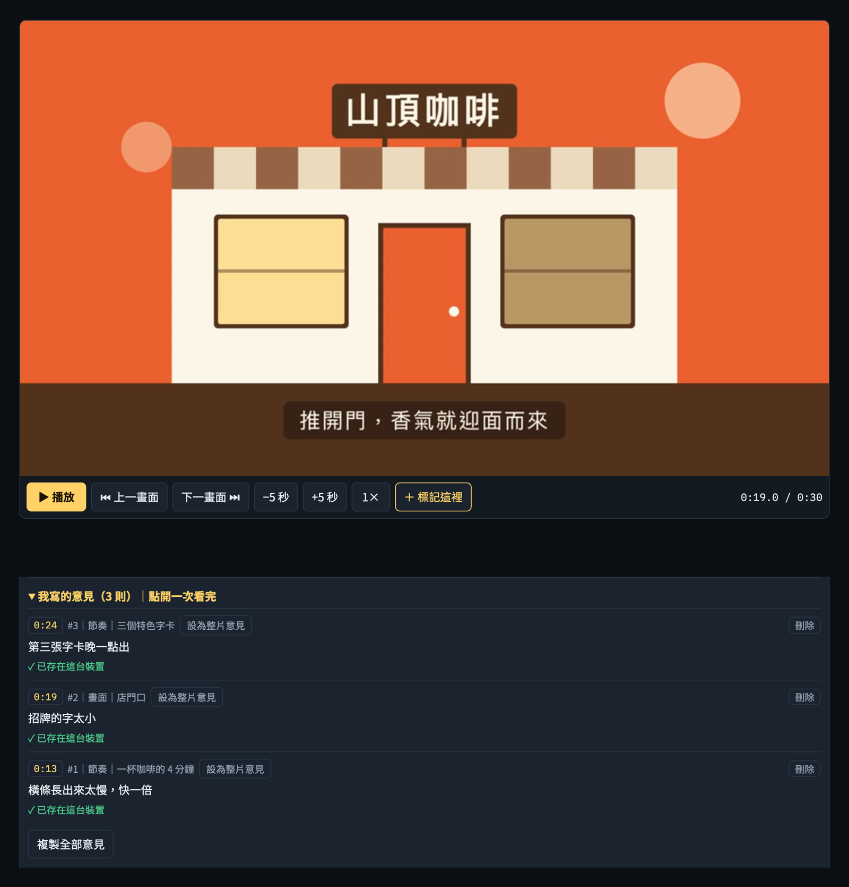

# 審片台 Review Desk

**AI 做片，你審片。點哪裡，它就改哪裡。**

審片台是一個給 AI 代理（Claude Code、Codex 等）用的技能：把一支成片變成一個審片網頁。你在畫面上寫意見，AI 收到的每一則都帶著時間、鏡頭名和素材來源，只改你點到的那一鏡。



[介紹網頁與線上示範](https://betterconnie.github.io/review-desk/)　｜　[操作說明](references/操作說明.md)　｜　[English](#english)

## 它解決什麼

你看完 AI 做的片，回對話打「1 分 23 秒那邊怪怪的」。它改了 1 分 20 秒的字卡，你說的是 1 分 25 秒的轉場。再講細一點，它把整段重做，原本沒問題的鏡頭也換掉了。

片子是一格一格的，對話框只有一行。

## 有什麼

- **魚骨時間軸**：整支片每個鏡頭排成一列縮圖，旁邊是聲音大小和字幕。
- **每一鏡的身分證**：停在哪一鏡，就顯示它多長、怎麼做的、素材從哪來。
- **看到哪，寫到哪**：按「＋標記這裡」把意見釘在那一秒。打的字當下就存，重新整理也還在。
- **整份交給 AI**：按一顆鈕，全部意見變成一份清單。

  ```
  【v1】審片台傳來：意見 2 則；整版還沒核准。
  [0:13｜鏡頭 4〈一杯咖啡的 4 分鐘〉｜自製，無外部素材] 橫條長出來太慢
  [0:19｜鏡頭 5〈店門口〉｜自製，無外部素材] 招牌的字太小
  ```

- **你按核准才算過關**：「核准這個版本」要按兩次才生效；出了新版本，舊的核准自動不算。
- **手機也能審。**
- **片子留在你的電腦**：預設只開一個本機網頁，影片和意見都不上傳（頁面只會向 Google Fonts 要字型檔）。

## 安裝

需要 Python 3.9 以上和 ffmpeg。不用裝任何套件。

Claude Code：

```bash
git clone https://github.com/betterconnie/review-desk ~/.claude/skills/review-desk
```

其他 AI 代理：把這個資料夾放到它讀得到技能的地方，或直接請它讀 `SKILL.md`。

裝好後跑一次自我檢查：

```bash
python3 ~/.claude/skills/review-desk/scripts/make_board.py --selftest
```

## 使用

跟你的 AI 代理說：「片子做好後開審片台給我看。」它會照 `SKILL.md` 做。

想自己動手：

```bash
python3 scripts/make_board.py 成片.mp4 --out review_v1 --title "片名" --ver v1
cd review_v1 && python3 -m http.server 8787 --bind 127.0.0.1
```

打開 `http://127.0.0.1:8787/`。沒給鏡頭清單時，程式會自動偵測鏡頭切換點；有清單（`--shots shots.json`）的話，每一鏡會多顯示怎麼做的、素材來源。

先玩示範片：

```bash
python3 scripts/make_board.py demo/demo.mp4 --shots demo/demo.shots.json --srt demo/demo.srt --out review_demo
cd review_demo && python3 -m http.server 8787 --bind 127.0.0.1
```

然後打開 `http://127.0.0.1:8787/`。

## 要給客戶或同事審（選用）

`cloud/` 可以把多個審片台組成一個網站放上 Netlify：一個固定網址，換手機電腦意見都在，對方不用註冊。做法和注意事項在 [cloud/README.md](cloud/README.md)。沒設密碼之前，拿到網址的人都看得到片。

## 檔案

| 位置 | 內容 |
|---|---|
| `SKILL.md` | 給 AI 代理看的技能說明 |
| `scripts/make_board.py` | 影片 → 審片台資料夾 |
| `assets/page.tpl.html` | 審片台網頁模板（單檔，無框架） |
| `references/操作說明.md` | 給審片的人看的說明 |
| `references/data-format.md` | 資料格式（進階） |
| `cloud/` | 選用的雲端同步（Netlify Functions＋Blobs） |
| `demo/` | 示範片〈山頂咖啡｜開幕預告〉，原創，CC0 |
| `docs/` | 介紹網頁 |

## 已知限制

- 自動鏡頭偵測看的是亮度差，顏色不同但亮度接近的切換會漏掉。用 `--scene 0.1` 或自己列鏡頭清單。
- 本機模式的意見只存在那一台電腦的瀏覽器。
- `--out` 指到已經有別的檔案的資料夾時會拒絕執行，免得蓋掉你的東西。
- 雲端後台是給一個人審用的：兩個人同時改同一則，後寫的蓋掉先寫的。
- 頁面字型從 Google Fonts 載入；離線時會退回系統字型。
- 目前只實際配過 Claude 使用。意見是一段文字，貼給哪個 AI 都行。

## 來歷

這套是做兩個 YouTube 頻道時，被「講不清楚哪裡要改」逼出來的。用了幾集之後整理成公開版。

## 授權

程式：[MIT](LICENSE)。示範片：CC0。

回報問題或建議：開 [Issue](https://github.com/betterconnie/review-desk/issues)。

---

## English

**Review Desk** is a skill for AI coding agents (Claude Code, Codex, and others) that turns a finished video into a single-page review board.

When an agent makes a video for you, telling it what to fix is the slow part. "Something's off around 1:23" gets the wrong shot changed. Review Desk lays the film out as a timeline of shots. You pin comments to exact moments, and the agent receives a list where every comment carries the timestamp, the shot name, and the source file.

- Shot timeline with thumbnails, audio level, and subtitles
- Per-shot details: duration, how it was made, where the asset came from
- Pin comments to any second; drafts are saved as you type
- One click exports every comment as text for the agent
- Explicit approval per version (double-confirm; a new version resets it)
- Works on phones
- Local by default: nothing is uploaded

Requires Python 3.9+ and ffmpeg. No packages to install.

```bash
git clone https://github.com/betterconnie/review-desk ~/.claude/skills/review-desk
python3 ~/.claude/skills/review-desk/scripts/make_board.py your-video.mp4 --out review_v1 --ver v1
cd review_v1 && python3 -m http.server 8787 --bind 127.0.0.1
```

The interface is in Traditional Chinese. MIT licensed.
